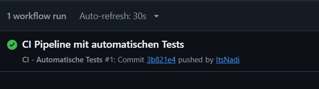
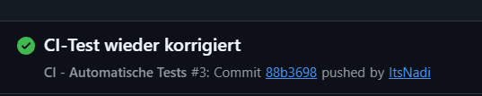

# Dokumentation – CI/CD mit GitHub Actions

## Ziel
Bei jedem Push sollen die Tests unseres Node.js-Backends automatisch ausgeführt werden. So können Fehler frühzeitig erkannt werden.

## Umsetzung
Die Pipeline ist in `.github/workflows/ci.yml` definiert. GitHub Actions startet den Workflow bei jedem Push; zusätzlich ist ein manueller Start möglich. Auf einem Ubuntu-Runner wird das Repository ausgecheckt, Node.js 22 eingerichtet, im Ordner `backend` werden mit `npm install` die Abhängigkeiten installiert und anschließend mit `node --test tests/ci.test.js` die Tests ausgeführt.

Die drei Tests prüfen, ob das Startskript richtig eingetragen ist, Express als Abhängigkeit vorhanden ist und die `package.json` den erwarteten Namen enthält.

## Ablauf und Ergebnis
**1. Erfolgreicher Durchlauf:** Nach Commit `3b821e4` wurde die Pipeline automatisch gestartet und erfolgreich abgeschlossen. Zuvor bestanden die drei Tests auch lokal.

**2. Fehlerdemonstration:** Im dritten Test wurde absichtlich der erwartete Paketname von `backend` auf `falscher-name` geändert. Nach Commit `39055be` schlug die Pipeline wie erwartet fehl (rotes X). Damit wurde gezeigt, dass ein fehlerhafter Test erkannt wird.

**3. Korrektur:** Der Test wurde wieder auf den richtigen Namen `backend` zurückgesetzt. Nach Commit `88b3698` lief die Pipeline erneut erfolgreich durch.

## CI/CD-Begriffe
- **CI (Continuous Integration):** Codeänderungen werden regelmäßig und automatisch geprüft, zum Beispiel durch Tests nach jedem Push.
- **CD (Continuous Delivery/Deployment):** Automatische Bereitstellung oder Veröffentlichung von Software. Das wurde in dieser Aufgabe nicht umgesetzt.
- **Pipeline:** Abfolge automatisierter Arbeitsschritte.
- **Workflow:** Die YAML-Datei, die die GitHub-Actions-Schritte festlegt.
- **Runner:** Die Umgebung, auf der die Schritte ausgeführt werden.

## Fazit
Die CI-Pipeline funktioniert. Sie führt Tests nach einem Push automatisch aus, zeigt Fehler an und bestätigt nach der Korrektur wieder einen erfolgreichen Durchlauf.

**Repository:** https://github.com/ItsNadi/bewertungsapp-preiss
